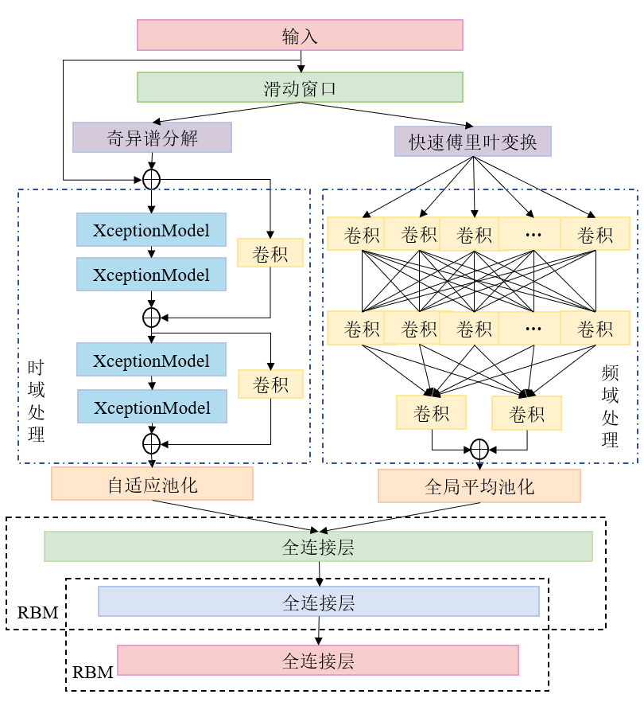

</think>

# dbn_ems_remake
## Overview
This project is an improvement based on my undergraduate thesis: "Design and Analysis of an Intelligent Recognition System for Rehabilitation Robot EMG Signals Based on Deep Convolutional Belief Networks". Building upon the original requirements:

1. Removed the direct classification using Deep Belief Networks (DBN)
2. Introduced Singular Spectrum Analysis (SSA) for noise reduction
3. Introduced Fast Fourier Transform (FFT) to extract frequency-domain information from the raw signal
4. Introduced the [Xception](https://arxiv.org/pdf/1911.03803.pdf) architecture to reduce network complexity and accelerate training speed
   
5. Introduced [omni-block](https://arxiv.org/abs/2002.10061) to achieve efficient processing of frequency-domain information

6. Utilized DBN to integrate time- and frequency-domain information to obtain the final results (limited by the graduation thesis title)
---
Raw data is stored in the `./data/` folder; parameters for each component can be modified in `option.py`; the execution mode can be freely changed in `main.py`; the final model will be saved in the `./models/` folder.

---
The overall network architecture is shown below:

## Installation
1. Install [conda](https://conda.io/projects/conda/en/latest/user-guide/install/index.html) (tip: using [mamba](https://github.com/conda-forge/miniforge) can significantly speed up package installation)

2. Clone this repository

    `git clone https://github.com/zhaosiyuan1098/dbn_ems_remake.git`

3. Create a virtual environment in the project directory

    `conda env create -f environment.yaml`

4. Activate the environment

    `conda activate dbn_ems_remake`

4. Run `main.py`

Alternatively, you can configure the environment yourself. For specific environment details, refer to [environment.yaml](environment.yaml).

## Results

### t-SNE Visualization of Raw sEMG Signals

### Single-Subject Training

### Multi-Subject Training

## Project Limitations
1. The DBN training process is complex and slow; using it at the final stage to integrate results is like "using a cannon to kill a mosquito". Considering replacing it with other methods.
2. The SSA implementation was written from scratch; its runtime efficiency is not high. I plan to introduce [pymssa](https://github.com/kieferk/pymssa) later.
3. Cross-subject performance is suboptimal (though significantly improved compared to the original DBN). I plan to introduce transfer learning in the future.

## References
* [tsai](https://github.com/timeseriesAI/tsai)
* Fawaz, H. I., Lucas, B., Forestier, G., Pelletier, C., Schmidt, D. F., Weber, J. & Petitjean, F. (2019). InceptionTime: Finding AlexNet for Time Series Classification. arXiv preprint arXiv:1909.04939.
* Rahimian E, Zabihi S, Atashzar S F, et al. Xceptiontime: independent time-window xceptiontime architecture for hand gesture classification[C]//ICASSP 2020-2020 IEEE International Conference on Acoustics, Speech and Signal Processing (ICASSP). IEEE, 2020: 1304-1308.
* Tang W, Long G, Liu L, et al. Omni-Scale CNNs: a simple and effective kernel size configuration for time series classification[J]. arXiv preprint arXiv:2002.10061, 2020.
